# ZCode Pro

[简体中文](README.md) | English

ZCode Pro enhances the ZCode desktop UI. No client files are modified; just launch via the ZCode Pro shortcut or the `zcode-pro` terminal command.

[](https://www.npmjs.com/package/zcode-pro) [](https://pypi.org/project/zcode-pro/) [](https://aur.archlinux.org/packages/zcode-pro) [](https://github.com/duanluan/zcode-pro#-windows) [](https://github.com/duanluan/zcode-pro#-linux--macos) [](https://github.com/duanluan/zcode-pro#-linux--macos) [](https://github.com/duanluan/zcode-pro#-community) [](https://github.com/duanluan/zcode-pro#-community)

> **Opening settings: after launching ZCode Pro, right-click the settings button (gear) at the bottom of the ZCode sidebar to open the ZCode Pro settings window.**

## ✨ Features

Grouped by where each feature lives in the settings window: the category column is the tab, entries with `·` (e.g. "Behavior · Global prompt") are sub-tabs, in the same order as the screenshots in the Settings section below.

| Category | Feature | Description |
| --- | --- | --- |
| Features | Project menu actions (open folder / copy path) | Project "More" menu: open the project directory in the file manager, or copy its path |
| | ~~Custom project alias~~ (retired) | Show a custom name for a project in the sidebar; UI-only, revert anytime; renaming is built into ZCode ≥ 3.16.1 (project menu "Edit project") — the feature disables itself there and offers to migrate existing aliases |
| | ~~Switch project folder~~ (retired) | Point a project at another folder; sidebar, tabs and task history follow. Stop running tasks before switching; historical checkpoints still reference the original path; retired on ZCode ≥ 3.16.1, where a project can hold multiple directories natively |
| | Session drag ordering | Reorder sessions in Pinned, Projects and Groups; persists across refreshes |
| | Session quick switch | `alt+z` toggles between the current and the last session; hold `alt` and press `x` (up) / `c` (down) to pick from recent sessions (10 shown initially, pressing `c` at the bottom loads 5 more), `alt+e` opens the last 10 directly, `alt+r` opens running / finished-but-unseen tasks; arrow keys also move the highlight, press `Enter` or click a row to switch; the five trigger keys are customizable in Settings → Shortcuts |
| | Keep renamed session titles | Sessions you renamed keep their custom title; auto-generated titles no longer overwrite it in the sidebar |
| | Collapsible Pinned section | The sidebar "Pinned" header collapses/expands its task list; the state is remembered |
| | File menu actions | Adds "Open with default app" and "Reveal in file manager" to file links in chat |
| | Copy image | Right-click an image in chat or the enlarged preview to copy it to the clipboard |
| | Plugin card sandbox reclaim | Releases the oldest plugin-card sandboxes once the cap is hit (the one being viewed goes last), so new cards keep opening after the 64-slot pool fills up; released cards come back when their session is reopened (cap adjustable via the sandboxReclaimBudget config file key) |
| | Plugin card auto-retry | Auto-clicks "Reload" on cards that failed the 64-slot cap, so they recover as soon as a slot frees up |
| | Running indicator while collapsed | While any session is running, collapsed projects and the "Tasks" / "Pinned" section headers show the same loader the running task row uses; it disappears when all finish |
| | Plugin panels on the new tab page | The built-in "new tab page" only lists built-in panels and recommended official plugins; this adds cards for third-party marketplace plugin panels (headroom, rtk, …) that open in the side pane |
| | Copy table | Adds a "Copy table" button to the table toolbar in answers: writes rich text to the clipboard so Excel / rich-text editors paste it as a real table (cells split, no borders or background colors); plain-text targets get tab-separated values |
| | Plugin updates | Check and update zcode-plugins marketplace plugins in one click, optional auto-update on startup |
| Shortcuts | Shortcut customization | Rebind the five session quick switch trigger keys (`alt+z` / `x` / `c` / `e` / `r` by default) one by one: click "Modify" and press a new key (letters/digits only, conflicts rejected); reset all to defaults in one click |
| Behavior · ZCode CLI | ZCode CLI | Skill listing check: counts the full listing against the injection budget, warns when it degrades to names only and suggests a budget; configure the skill system, listing budget, extra skill directories and feature switches; workspace memory stays in the official settings under Settings → Agent capabilities → Memory; changes apply to new sessions |
| Behavior · Global prompt | Global prompt | Edit default instructions shared by all projects; applies to new sessions |
| Behavior · Task title prompt | Task name prompt | When a new session starts answering, generates the task name with a provider and prompt you choose (following the current session and glm-5.3-flash by default; every question sent before the first answer counts), saved as a manual rename the built-in auto title never overrides; provider, model and prompt are editable in settings, with a test button |
| Appearance · Styles | Sidebar menu in the top bar | Turns "New task / Search / Automations / Plugin store" into icon buttons in the top navigation bar, highlighted while its view is open|
| | Font adjustment | Custom UI font (all interface text except the terminal), question font and answer font |
| | Sidebar spacing | Fine-tune sidebar project spacing and task spacing |
| | UI style adjustments | Fine-tune paragraph spacing, content width, line heights, list/quote/table spacing and cell padding; focusing an input highlights the affected areas |
| Appearance · Status bar | Status bar statistics | Shows statistics at the bottom-right of the input box and at the end of each answer: context usage (color-shifts when high), questions asked, today/total tokens and task count, all from official data; reorder or hide each item under Settings → Appearance → Status bar |
| | Per-turn token usage | Shows that turn's in/out tokens and cache hit rate after the time in each answer's action row (local records keep only a recent window; older answers stay unlabelled) |
| Appearance · Theme | UI skins | Eleven famous editor theme palettes (Dracula / Nord / Tokyo Night / Catppuccin / Gruvbox / One Dark / Solarized / Rosé Pine / Everforest / Night Owl / Kanagawa), auto-matching ZCode's light / dark mode; plus a custom theme: pick 5 colors each for light and dark to derive the whole palette, |
| Appearance · Background | Background image | Window-wide background from four sources: none / local library (upload many, pick the active one, delete freely) / folder (read in place, rotate on a timer, random or by filename) / URL (refresh on a timer for random-image APIs); three sliders — mask opacity (image fading toward the theme background color), image blur, panel opacity (the left, center and right panes); the panes reveal the background while menus and dialogs stay opaque; the library uploads with the zcode-pro WebDAV sync group (overwrite, no history versions) |
| Performance | Idle project memory reclaim | Projects unused for a while with no running tasks release their memory automatically, and unused ones are reclaimed once after startup; sessions are untouched and reload when reopened (durations adjustable) |
| Proxy | Software proxy | Set an HTTP proxy for plugin updates/installs and tool upgrades, with connectivity test |
| Sync | Settings sync | Manually back up ZCode Pro settings and model settings to WebDAV, or restore them on a new computer; transfers only on click |
| Vision | Vision proxy | Automatically hand images to vision models for recognition when the main model cannot see them, and feed the descriptions to the main model; visual chain editor (zcode-vision plugin) |
| Headroom | Headroom | Manage compression device, power-save switching and proxy status; check and upgrade the headroom program (headroom plugin) |
| rtk | rtk compression | Manage rewrite hints and the command whitelist; check and upgrade the rtk program (rtk plugin) |

All features can be toggled or adjusted in the settings window; works on both ZCode 3.16.1 and 3.15.x.

## 🎛 Settings

Right-click the settings button (gear) at the bottom of the ZCode sidebar to open the settings window:

| Features | Shortcuts | Behavior · Global prompt |
| --- | --- | --- |
| 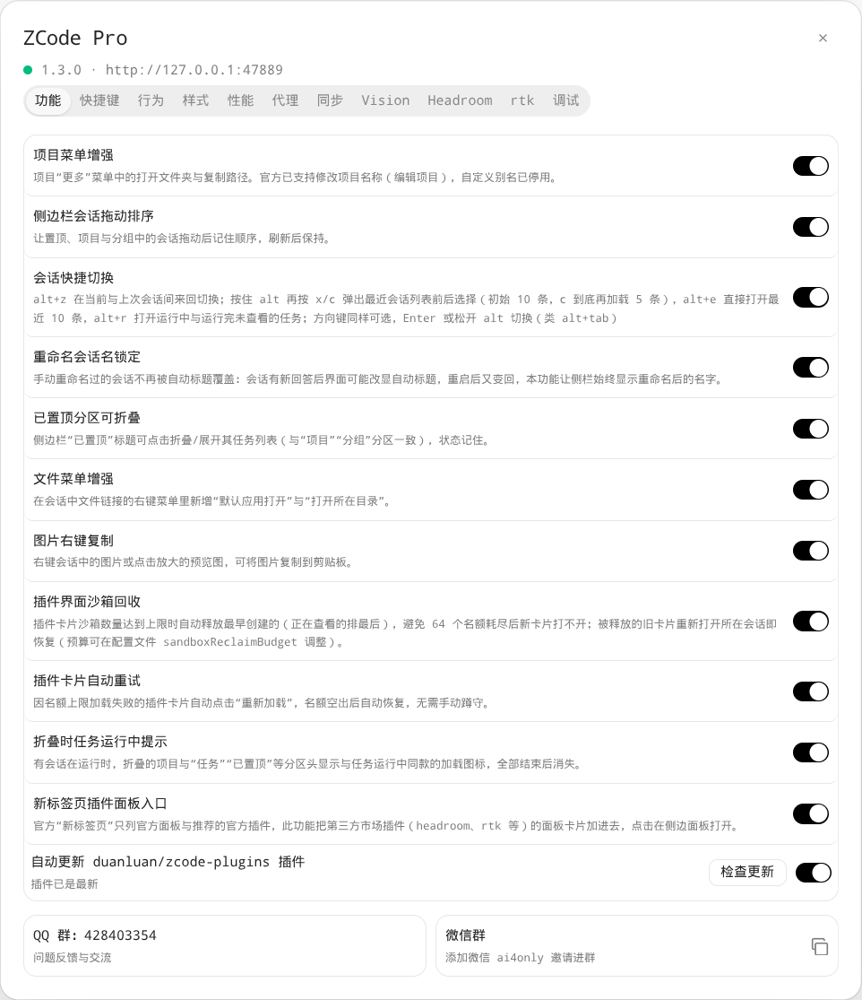 | 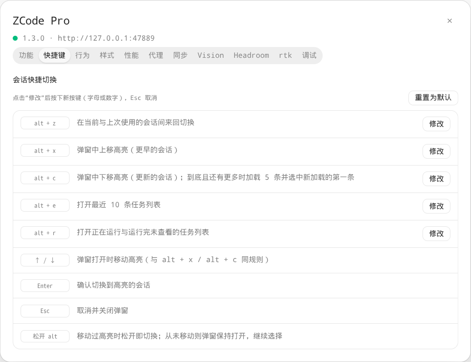 | 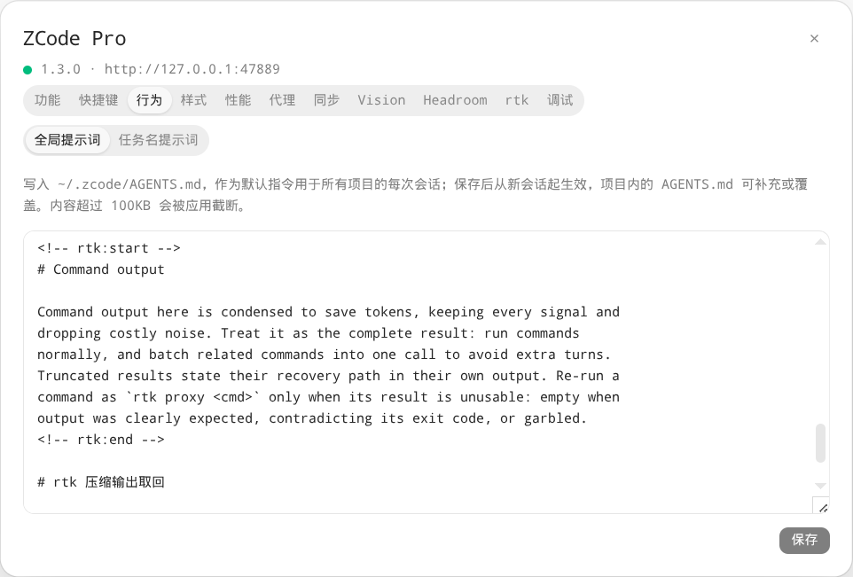 |

| Behavior · Task title prompt | Appearance · Styles | Appearance · Status bar |
| --- | --- | --- |
| 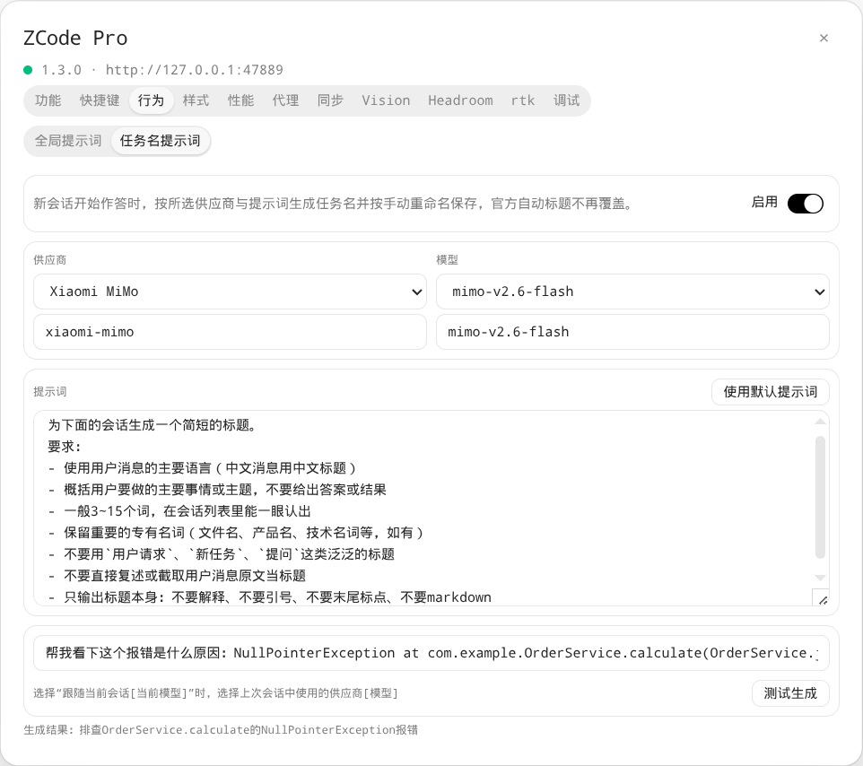 | 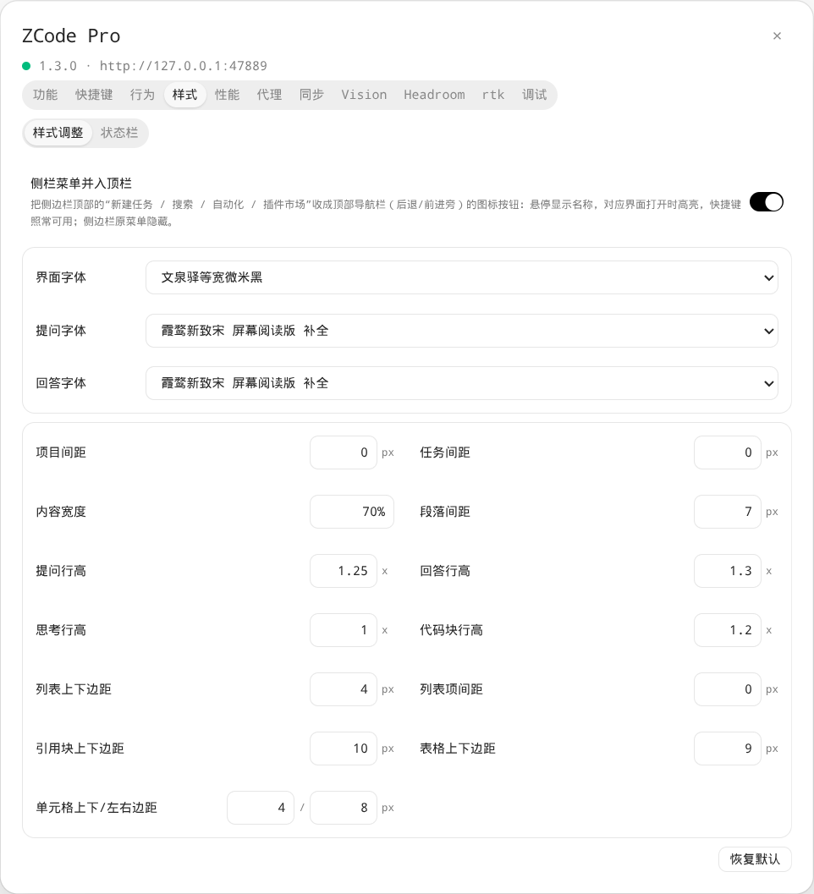 | 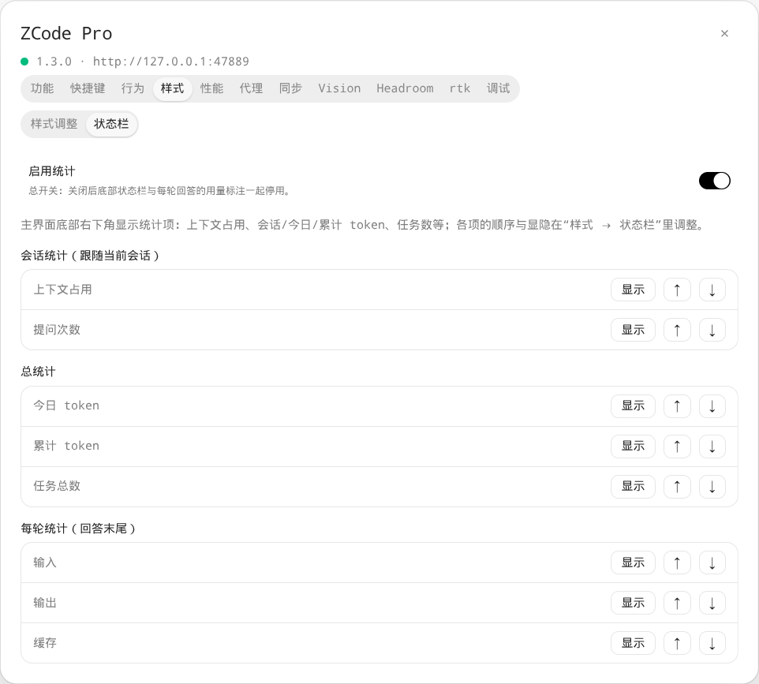 |

| Performance | Proxy | Sync |
| --- | --- | --- |
| 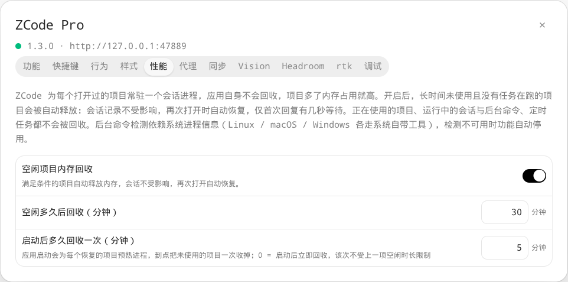 | 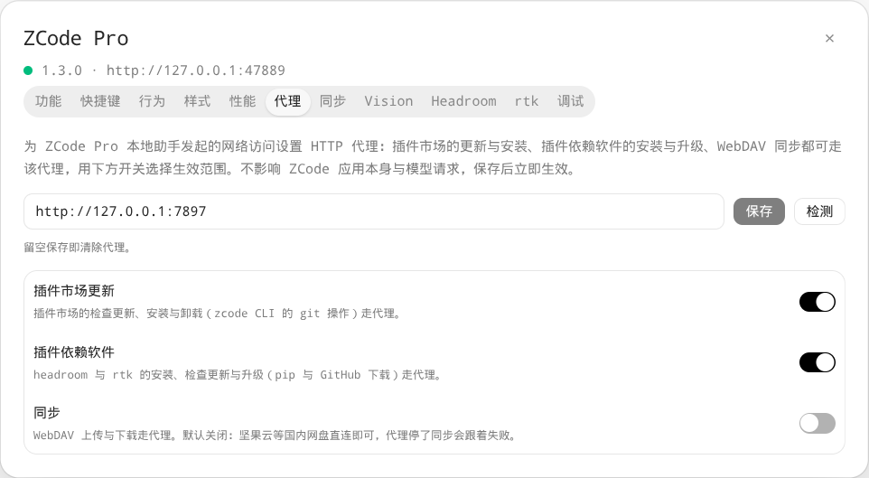 | 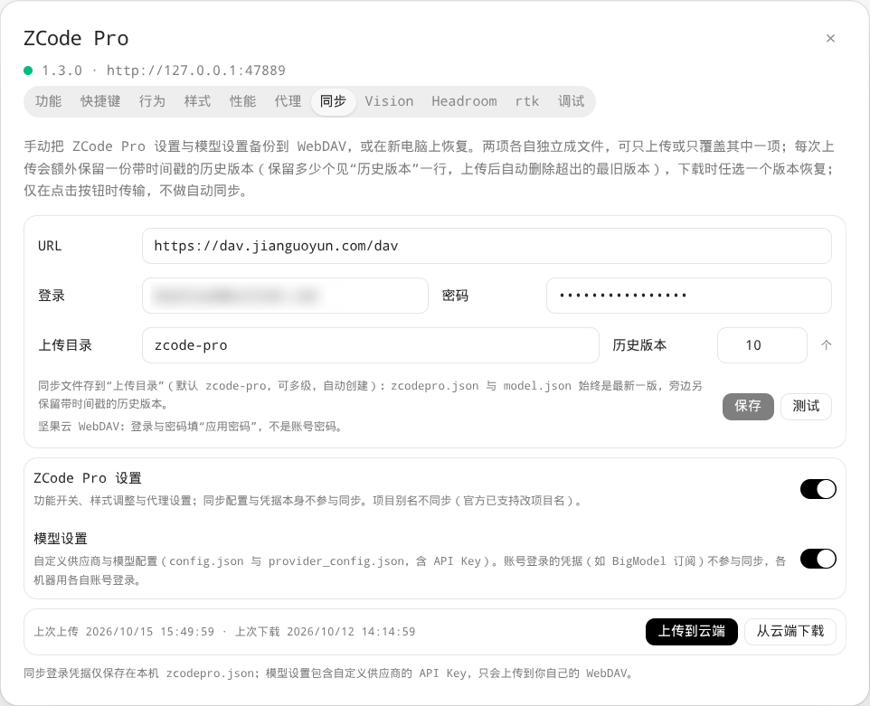 |

| Vision | Headroom | rtk |
| --- | --- | --- |
| 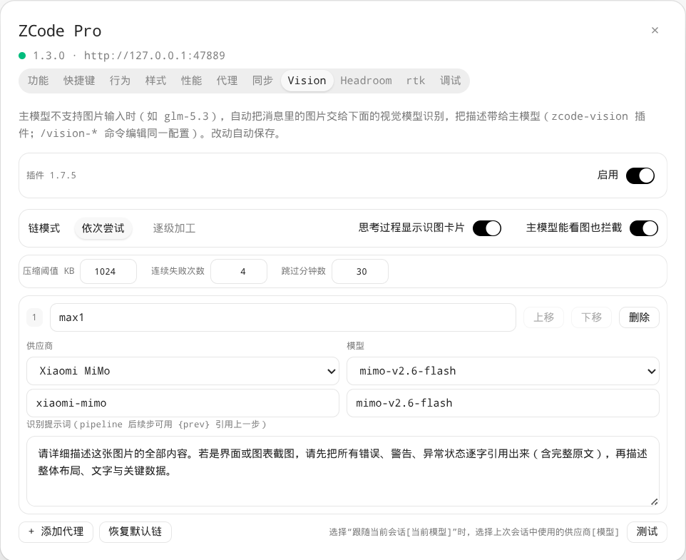 | 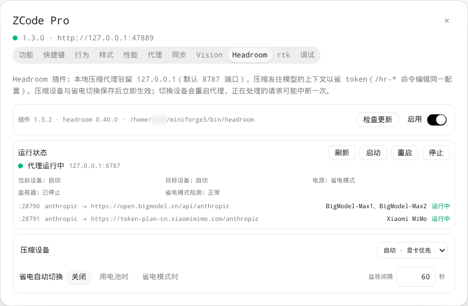 | 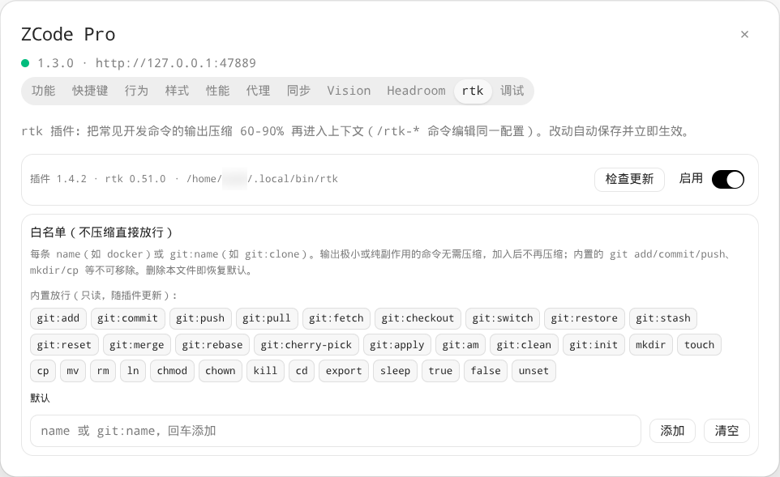 |

> The last three tabs (Vision / Headroom / rtk) come from the plugins of the same name; when a plugin is missing, the tab shows a one-click install card and switches to the full panel once installed.

## 📦 Installation

> **Version match**: for ZCode ≥ 3.16.1 use **zcode-pro 1.1.0** (latest npm / PyPI / AUR release); for ZCode ≤ 3.15.x use **zcode-pro 0.20.3** (the previous release, still available).

Once installed, launch ZCode via the "ZCode Pro" shortcut in your app menu / Start menu, or the `zcode-pro` command in a terminal — the enhancements are enabled automatically in this mode; launching ZCode through its original entry does not load them. After launching, right-click the settings button at the bottom of the ZCode sidebar to open the ZCode Pro settings window.

### 📦 npm / PyPI

At runtime the Node runtime bundled with ZCode is preferred; if ZCode cannot be found, system Node.js (≥ 22) is used.

```bash
# Option 1: install/uninstall via npm
npm install -g zcode-pro
npm uninstall -g zcode-pro
# Option 2: install/uninstall via pip
pip install zcode-pro
pip uninstall zcode-pro

# Launch via the command
zcode-pro
# Add a Start-menu shortcut
zcode-pro setup
# Add a Start-menu shortcut + a desktop shortcut
zcode-pro setup --desktop
# Undo the shortcuts
zcode-pro setup --uninstall
```

### 🐧 Linux / macOS

```bash
git clone https://github.com/duanluan/zcode-pro.git
cd zcode-pro && ./scripts/install.sh
```

- Installs to `~/.local`; use `PREFIX=` to choose another location;
- On Linux, registers an app-menu shortcut "ZCode Pro" (icon reused from the installed ZCode);
- Do not use this script while the AUR package is installed (the script detects this and refuses): the user-level install would shadow the system-wide one;
- Uninstall: `./scripts/install.sh --uninstall`.

### 🪟 Windows

Run with **PowerShell (Admin)**:
```powershell
git clone https://github.com/duanluan/zcode-pro.git
cd zcode-pro

# Add a Start-menu shortcut
powershell -ExecutionPolicy Bypass -File scripts\install.ps1
# Add a Start-menu shortcut + a desktop shortcut
powershell -ExecutionPolicy Bypass -File scripts\install.ps1 -Desktop
# ZCode in a non-default directory that auto-detection misses? Pass its path (persisted, removed on uninstall)
powershell -ExecutionPolicy Bypass -File scripts\install.ps1 -Desktop -ZCodePath "D:\ProgramFiles\Zcode\ZCode.exe"

# Uninstall
powershell -ExecutionPolicy Bypass -File scripts\install.ps1 -Uninstall
```

### 📦 AUR (Arch / Manjaro)

Installs `/usr/bin/zcode-pro` and a system-level app-menu shortcut. Depends on the [zcode](https://aur.archlinux.org/packages/zcode) package from the AUR.

```bash
yay -S zcode-pro
paru -S zcode-pro
# Manual installation
git clone https://aur.archlinux.org/zcode-pro.git && cd zcode-pro && makepkg -si
```

If you previously installed via `install.sh`, run `./scripts/install.sh --uninstall` in that repository clone before switching to the AUR package. Leftover user-level files would keep shadowing the system-wide entry, and you would keep launching the old version.

### 🚀 Run without installing

No standalone Node.js required: the runtime bundled with ZCode is preferred and used even without a system Node; works whether ZCode is installed in the default or a custom directory (auto-detected, falling back to the registry).

```bash
git clone https://github.com/duanluan/zcode-pro.git && cd zcode-pro

# Linux / macOS (auto-detects /opt/ZCode, /Applications/ZCode.app)
./bin/zcode-pro
# Windows (auto-detects default locations, falls back to the registry)
bin\zcode-pro.cmd

# Manually add a Start-menu shortcut (--desktop also adds a desktop shortcut, --uninstall undoes)
./bin/zcode-pro setup
bin\zcode-pro.cmd setup
```

## 📖 Reference

Command-line options (see `zcode-pro --help` for all):

| Option | Description |
| --- | --- |
| `--cdp-port` | Debug port, default 9333 |
| `--helper-port` | Local helper port, default 47889 |
| `--zcode-path` | Explicit path to the ZCode executable |
| `--inject-only` | Attach to a running instance only; do not launch a new one |
| `--verbose` | Verbose logging |
| `setup [--desktop] [--uninstall]` | Install/undo local shortcuts (`--desktop` also adds a desktop one) |

Each option can also be overridden with a `ZCODEPRO_*` environment variable.

Configuration and data locations:

| Content | Location |
| --- | --- |
| Feature switches, aliases, software proxy | `~/.zcode/zcodepro.json` |
| Startup diagnostics log (silent shortcut launches, Windows) | `~/.zcode/zcodepro.log` |
| Global prompt | `~/.zcode/AGENTS.md` |
| ZCode behavior settings (skill listing budget etc.) | `~/.zcode/cli/config.json` |
| Vision proxy (zcode-vision plugin) | `~/.zcode/zcode-vision.json` |
| rtk compression (rtk plugin) | `~/.zcode-rtk/` |
| Headroom (headroom plugin) | `~/.zcode/headroom.json` |

After uninstalling, just start ZCode from the official entry; no system cleanup is needed.

## 🔌 Plugin recommendation

[duanluan/zcode-plugins](https://github.com/duanluan/zcode-plugins) is a companion plugin marketplace for ZCode: AI code review, request compression and command-output compression plugins that save tokens. To install: ZCode → Plugin Marketplace → "Add" (top right) → Add plugin marketplace, and enter `duanluan/zcode-plugins`. Installed plugins can be checked and updated from ZCode Pro settings.

## 💬 Community

- QQ group: **428403354** ([join](https://qm.qq.com/q/WXuISJK3ug))
- WeChat group: add **ai4only** on WeChat to be invited

<p>
  
  &nbsp;&nbsp;
  
</p>
